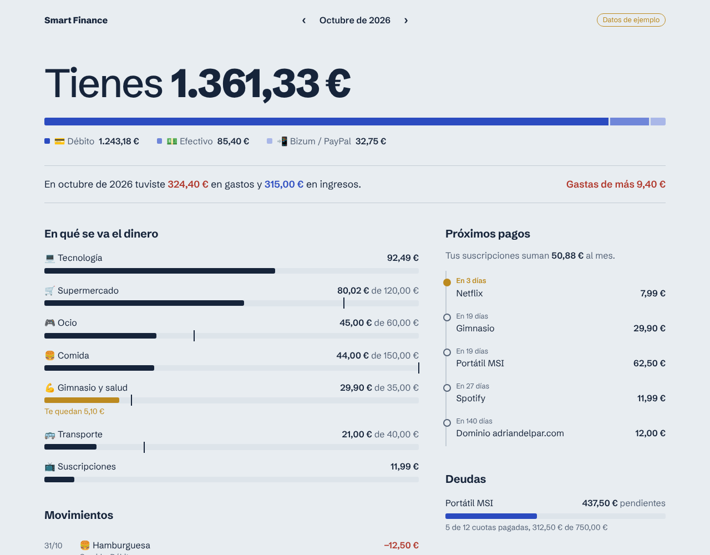

# Smart Finance


Gestor de gastos personal. Registro cada gasto en segundos desde un botón del centro de control del móvil, y lo gestiono todo desde una aplicación web en el portátil: movimientos filtrados y agrupados por mes, cuenta o categoría, presupuestos, suscripciones y deudas. Los datos viven en Notion.



## Arquitectura

```
 ┌───────────────────────┐                                 ┌──────────────────────────┐
 │ Android (HyperOS)     │   POST /pages (crear)           │                          │
 │ HTTP Shortcuts        │ ──────────────────────────────► │   API REST de Notion     │
 │ src/finanzas.js       │   POST /databases/{id}/query    │                          │
 └───────────────────────┘                                 │  Movimientos, Cuentas,   │
   meter gastos, desde donde sea                           │  Categorías,             │
                                                           │  Suscripciones, Deudas   │
 ┌───────────────────────┐                                 │                          │
 │ Portátil (Docker)     │   query, POST y PATCH /pages    │                          │
 │ Flask + gunicorn      │ ──────────────────────────────► │                          │
 │ web/app               │   (leer, crear, editar, borrar) └──────────────────────────┘
 └──────────▲────────────┘
            │ http://localhost:8000
        navegador
```

- **Notion es el backend.** Guarda los datos y calcula los saldos con fórmulas y rollups. Ver el [modelo de datos](docs/modelo-datos.md).
- **El móvil es un cliente para escribir.** Un script de [HTTP Shortcuts](https://http-shortcuts.rmy.ch/) que lee cuentas, categorías, suscripciones y deudas para montar los menús y crea el movimiento. No hay nada cableado: si añado una cuenta en Notion, aparece sola en el móvil.
- **El portátil es el cliente para gestionar.** Una web en Flask, dentro de Docker, para ver, filtrar, agrupar, crear, editar y borrar. El token se queda en el servidor y nunca llega al navegador. Ver [docs/web.md](docs/web.md).

## Qué hace

### Desde el móvil

Al pulsar el botón **Finanzas**:

1. ¿Qué quieres registrar? → gasto, ingreso o transferencia
2. Gasto **único** → concepto, importe, cuenta, categoría
3. Gasto **recurrente** → elige una suscripción o una deuda; sugiere el importe y rellena cuenta y categoría
4. Guarda en Notion y muestra el saldo actualizado de la cuenta

Cancelar cualquier pregunta no guarda nada. Los importes aceptan coma decimal (`12,50`).

### En el portátil

```bash
cp .env.example .env     # y pon tu NOTION_TOKEN
docker compose up -d --build
```

Y abre <http://localhost:8000>. Sin token arranca con datos de ejemplo (editables).

- **Resumen**: saldo por cuenta, balance del mes frente al anterior, gráfico de 12 meses, presupuesto por categoría, próximos pagos y deudas.
- **Movimientos**: filtros por periodo, tipo, cuenta, categoría y texto; agrupados por mes, día, cuenta, categoría o tipo con subtotales; exportar a CSV.
- **Añadir, editar y eliminar** movimientos, cuentas, categorías, suscripciones y deudas.

### En el móvil, como app

La web es instalable (PWA). Un contenedor de [Tailscale](docs/web-en-el-movil.md) junto a la web (patrón *sidecar*) la publica en tu red privada de Tailscale con HTTPS, sin abrir puertos del router y sin tocar el Tailscale que ya tenga el portátil. Desde el móvil se abre en cualquier sitio y se instala con icono propio y a pantalla completa.

## Estructura

```
src/finanzas.js              Script del atajo del móvil (HTTP Shortcuts)
tests/finanzas.test.js       Tests del atajo con la app y Notion simulados
web/app/esquema.py           Campos y tipos de cada entidad
web/app/repositorio.py       Interfaz de datos + repositorio en memoria (demo)
web/app/notion.py            Repositorio sobre la API de Notion (leer y escribir)
web/app/formularios.py       Lectura y validación de formularios
web/app/resumen.py           Cálculos, filtros y agrupaciones (funciones puras)
web/app/templates, static    HTML y CSS
web/tests/                   Tests de la web (pytest)
web/Dockerfile               Imagen con gunicorn y usuario sin privilegios
docker-compose.yml           Web en local (solo 127.0.0.1) + Tailscale opcional (perfil tailscale)
tailscale/serve.json         Proxy HTTPS de Tailscale hacia la web
docs/                        Modelo de datos, instalación en Android, guía de la web y de la web en el móvil
.github/workflows/ci.yml     Tests, build del contenedor y detección de tokens
```

## Desarrollo

```bash
npm test                          # atajo: 8 tests, sin dependencias (node:test)
cd web && pytest                  # web: 48 tests
docker compose up -d --build      # panel en http://localhost:8000
```

Los tests ejecutan el script real dentro de un sandbox de Node (`vm`), sustituyendo las funciones de HTTP Shortcuts (`prompt`, `showSelection`, `sendHttpRequest`…) por mocks. Así se prueba cada flujo sin móvil y sin tocar Notion.

## Seguridad

- El token de Notion vive solo en una variable de HTTP Shortcuts del móvil y en el `.env` del portátil. **Nunca** está en el código.
- La web escucha solo en `127.0.0.1`, protege todos los formularios con token CSRF y tiene contraseña opcional (`APP_PASSWORD`) para el día que se publique.
- La integración de Notion solo tiene acceso a la página Smart Finance.
- La CI falla si detecta algo con pinta de token de Notion (`ntn_…`) o clave de Tailscale (`tskey-…`) en el repositorio.

## Hoja de ruta

- [x] Atajo del móvil para gastos, ingresos, transferencias y pagos recurrentes
- [x] Aplicación web para el portátil: resumen, filtros, agrupaciones, CSV y gestión completa
- [x] Contenedor Docker y CI que lo construye y lo prueba
- [x] Gráfico de ingresos y gastos de los últimos 12 meses
- [ ] Importar movimientos desde el CSV del banco
- [ ] Publicarlo gratis (Render) para verlo fuera de casa
- [x] Instalable en el móvil como app (PWA), accesible desde fuera de casa con Tailscale

## Autoría

Proyecto personal de Adrián Delgado (2º ASIR, IES Gonzalo Nazareno), desarrollado con ayuda de IA (Claude, de Anthropic). La idea, las decisiones y la puesta en marcha son mías; la IA me ha ayudado a diseñar el modelo de datos y a escribir el código.

Licencia [MIT](LICENSE).
